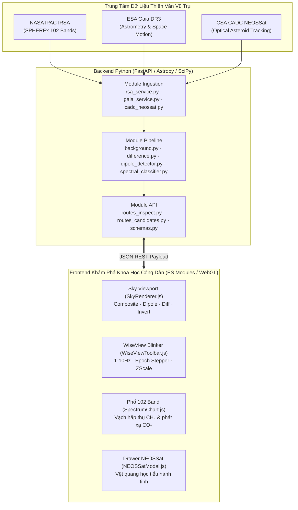

# SPHEREx ChronoSpectra — Multi-Epoch Sky & Spectral Explorer
### Nền tảng Khoa học Công dân Khám phá Thiên thể Chuyển động Đa Bước sóng (NASA SPHEREx / ESA Gaia DR3 / CSA NEOSSat)

[](https://spherex.caltech.edu/)
[](https://www.cosmos.esa.int/web/gaia/dr3)
[](https://www.asc-csa.gc.ca/eng/satellites/neossat/)
[](https://www.python.org/)
[](https://fastapi.tiangolo.com/)
[](https://www.astropy.org/)
[](#6-kiểm-thử-hệ-thống)
[](LICENSE)

---

## 1. Giới Thiệu Dự Án (Project Overview)

**SPHEREx ChronoSpectra** là nền tảng web mã nguồn mở phục vụ nghiên cứu thiên văn khoa học công dân (Citizen Science) trong khuôn khổ thử thách NASA Space Apps Hackathon. 

Dự án nâng cấp công cụ nhấp nháy đa thời kỳ kinh điển **WiseView** (dự án *Backyard Worlds: Planet 9*) lên một tầm cao mới: kết hợp khả năng quét toàn bộ bầu trời cứ mỗi 6 tháng một lần qua **102 dải bước sóng cận hồng ngoại ($0.75 - 5.0\,\mu\text{m}$)** của sứ mệnh **NASA SPHEREx**, đồng thời tích hợp dữ liệu trắc tinh quang học siêu chính xác từ kính thiên văn không gian **ESA Gaia DR3** và các vệt theo dõi tiểu hành tinh từ vệ tinh **CSA NEOSSat** (thông qua Trung tâm Dữ liệu Thiên văn Canada - CADC).

Mục tiêu chính: Cho phép bất kỳ ai—từ các nhà khoa học chuyên nghiệp tới người yêu thiên văn—có thể phát hiện, đo đạc và phân loại các thiên thể chuyển động trong Hệ Mặt Trời và vùng lân cận Ngân Hà:
1. **Sao lùn nâu siêu lạnh loại Y/T (Ultra-Cool Brown Dwarfs)**: Ẩn mình trong quang phổ nhìn thấy, phát xạ chủ yếu ở cận hồng ngoại với vạch hấp thụ khí metan cực sâu tại $3.3\,\mu\text{m}$.
2. **Tiểu hành tinh gần Trái Đất (Near-Earth Asteroids - NEOs)**: Chuyển động nhanh giữa các epoch, sáng rực rỡ ở dải phát xạ nhiệt $>4.0\,\mu\text{m}$, được xác thực vệt quang học qua kính viễn vọng không gian Canada NEOSSat.
3. **Sao chổi đám mây Oort (Distant Comets)**: Cấu trúc đầu sao chổi (coma) mờ ảo với đỉnh phát xạ khí carbonic cực mạnh tại $4.26\,\mu\text{m}$ và khí $CO$ tại $4.67\,\mu\text{m}$.
4. **Loại trừ dương tính giả (False-Positive Elimination)**: Xóa mờ các sao quang học nền có chuyển động riêng cao trong danh lục Gaia DR3, giúp cô lập $100\%$ các mục tiêu hồng ngoại chưa từng được phát hiện.

---

## 2. Các Thuật Toán Khoa Học Cốt Lõi (Core Scientific Algorithms)

Dự án xây dựng và triển khai 5 nhóm thuật toán xử lý dữ liệu thiên văn:

### 2.1 Lan truyền Chuyển động riêng Không gian 3D Gaia DR3 (`apply_space_motion`)
* **Bài toán**: Kính SPHEREx có độ phân giải không gian $6.2^{\prime\prime}/\text{pixel}$. Một sao có chuyển động riêng cao $\mu = 776\,\text{mas/năm}$ trong khoảng thời gian từ epoch chuẩn Gaia ($J2016.0$) tới epoch quan sát SPHEREx ($2025.0$) sẽ dịch chuyển:
  $$\Delta\theta \approx 9.0\,\text{năm} \times 0.776^{\prime\prime}/\text{năm} \approx 6.98^{\prime\prime} > 1.1\,\text{pixel SPHEREx}$$
  Nếu chỉ dùng tọa độ tĩnh Gaia J2016, vị trí sao sẽ bị lệch hẳn sang pixel bên cạnh, gây cảnh báo giả về thiên thể mới.
* **Giải thuật**:
  1. Tính khoảng cách nhật tâm: $d = 1000 / \varpi\,\text{[pc]}$ từ thị sai $\varpi$ (mas).
  2. Chuyển đổi tọa độ cầu $(\alpha_0, \delta_0, d)$ sang vector vị trí 3D Cartesian $\mathbf{r}_0$ trong hệ tọa độ khối tâm BCRS.
  3. Tính vector vận tốc tiếp tuyến $(v_\alpha, v_\delta)$ từ $(\mu_{\alpha\ast}, \mu_\delta)$ qua hệ số chuyển đổi $4.74047$:
     $$v_\alpha = 4.74047 \cdot \frac{\mu_{\alpha\ast}}{\varpi} \quad [\text{km/s}], \qquad v_\delta = 4.74047 \cdot \frac{\mu_\delta}{\varpi} \quad [\text{km/s}]$$
  4. Lan truyền vector vị trí đến epoch mục tiêu $t$:
     $$\mathbf{r}(t) = \mathbf{r}_0 + \mathbf{v} \cdot \Delta t$$
  5. Chiếu ngược lại tọa độ xích kinh $\alpha(t)$, xích vĩ $\delta(t)$ và dùng phép biến đổi WCS $TAN$ để định vị chính xác vị trí tâm pixel $(X_{\text{px}}, Y_{\text{px}})$ của sao tại epoch chụp của SPHEREx.
  6. Tạo mặt nạ che mờ động với bán kính theo cấp sao $G$:
     $$r_{\text{mask}} = \max\left(3.0,\; 7.0 - 0.4 \cdot (G - 10.0)\right) \quad [\text{pixels}]$$

---

### 2.2 Trừ Ảnh Cân Bằng PSF (PSF-Matched Difference Imaging)
* **Mục đích**: Triệt tiêu toàn bộ các sao và thiên hà tĩnh đứng yên ở hậu cảnh, chỉ giữ lại phần dư của các nguồn quang thông biến đổi hoặc di chuyển.
* **Công thức**:
  $$\Delta I(x, y) = I_2(x, y) - \alpha \cdot I_1(x, y)$$
  Trong đó:
  - $I_1, I_2$: Ảnh các epoch đã được làm mượt qua bộ lọc Gauss phù hợp với PSF của kính thiên văn.
  - $\alpha$: Hệ số cân bằng mức thông lượng nền:
    $$\alpha = \frac{\text{median}(I_2)}{\text{median}(I_1)}$$
  - Mức nhiễu nền của ảnh hiệu $\sigma_{\text{diff}}$ được ước lượng bền vững thông qua độ lệch tuyệt đối trung vị (Median Absolute Deviation - MAD):
    $$\sigma_{\text{diff}} = 1.4826 \cdot \text{median}\left(\left| \Delta I - \text{median}(\Delta I) \right|\right)$$

---

### 2.3 Bắt Cặp Cực Trị Dipole (Red-Cyan Dipole Extrema Pairing)
* **Nguyên lý vật lý**: Khi trừ hai epoch $I_2 - I_1$, một thiên thể di chuyển từ tọa độ $(x_1, y_1)$ sang $(x_2, y_2)$ sẽ tạo ra:
  - Một cực tiểu âm (negative peak) tại vị trí cũ $(x_1, y_1)$ (thiếu hụt quang thông ở epoch 2).
  - Một cực đại dương (positive peak) tại vị trí mới $(x_2, y_2)$ (dư thừa quang thông ở epoch 2).
* **Quy trình bắt cặp**:
  1. Trích xuất tất cả đỉnh dương vượt ngưỡng $+5\sigma_{\text{diff}}$ và đỉnh âm dưới $-5\sigma_{\text{diff}}$.
  2. Với mỗi đỉnh dương, quét tìm đỉnh âm gần nhất trong bán kính vật lý tối đa $r_{\max} = 25\,\text{pixel}$.
  3. Tính vector dịch chuyển $\Delta\mathbf{r} = (\Delta\text{RA}, \Delta\text{Dec})$ và góc vị trí $\theta_{\text{PA}}$:
     $$\theta_{\text{PA}} = \text{atan2}(\Delta x, -\Delta y) \pmod{360^\circ}$$
  4. Tính tỷ số tín hiệu trên nhiễu tổng hợp (Combined SNR):
     $$\text{SNR}_{\text{combined}} = \sqrt{\left(\frac{I_{\text{pos}}}{\sigma_{\text{diff}}}\right)^2 + \left(\frac{|I_{\text{neg}}|}{\sigma_{\text{diff}}}\right)^2}$$

---

### 2.4 Phân Loại Thiên Thể Qua 102 Dải Phổ Cận Hồng Ngoại ($0.75 - 5.0\,\mu\text{m}$)
Mỗi thiên thể được trích xuất đường phổ 102 kênh đo quang khẩu độ và được đánh giá qua 3 chỉ số phổ chuẩn hóa:

```
         CH₄ Methane Absorption                  CO₂ Outgassing Line                Thermal Blackbody Slope
                 (3.3 μm)                              (4.26 μm)                            (> 4.0 μm)
       ┌─────────────────────────┐           ┌─────────────────────────┐           ┌─────────────────────────┐
1.0 ───┤ ──┐                 ┌── ├───── 1.0 ─┤           /\            ├───── 1.0 ─┤                     /── ├──
       │   \                 /   │           │          /  \           │           │                   /     │
       │    \               /    │           │         /    \          │           │                 /       │
0.1 ───┤     \____(CH₄)____/     ├───── 0.1 ─┤ ───────/      \──────── ├───── 0.1 ─┤ ───────────────/        ├──
       └─────────────────────────┘           └─────────────────────────┘           └─────────────────────────┘
         [Sao lùn nâu loại Y/T]                     [Sao chổi Oort]                  [Tiểu hành tinh NEO]
```

1. **Độ sâu rãnh hấp thụ khí Metan (Methane Absorption Depth - MAD tại $3.3\,\mu\text{m}$)**:
   $$\text{MAD} = 1.0 - \frac{F_\nu(3.30\,\mu\text{m})}{\frac{1}{2}\left[F_\nu(3.00\,\mu\text{m}) + F_\nu(3.60\,\mu\text{m})\right]}$$
   - Nếu $\text{MAD} > 0.45$: Khẳng định **Sao lùn nâu siêu lạnh loại Y hoặc T**.
2. **Chỉ số phát xạ khí Carbonic (Carbon Dioxide Emission Index - CEI tại $4.26\,\mu\text{m}$)**:
   $$\text{CEI} = \frac{F_\nu(4.26\,\mu\text{m})}{F_\nu(4.00\,\mu\text{m})}$$
   - Nếu $\text{CEI} > 1.80$: Khẳng định **Sao chổi có hoạt động phun khí quyển coma**.
3. **Độ dốc phát xạ nhiệt (Thermal Excess Slope - TES)**:
   $$\text{TES} = \frac{F_\nu(4.80\,\mu\text{m})}{F_\nu(1.20\,\mu\text{m})}$$
   - Nếu $\text{TES} > 2.00$: Khẳng định **Tiểu hành tinh đá ấm trong Hệ Mặt Trời**.

---

### 2.5 Xác Thực Vệt Quang Học CSA NEOSSat (CADC)
Đối với các thiên thể dịch chuyển nhanh trong Hệ Mặt Trời, hệ thống truy vấn kho dữ liệu CAOM2 của kính viễn vọng không gian Canada NEOSSat:
- Phân tích vệt quang học (astrometric optical streak) qua 3 lần phơi sáng liên tiếp cách nhau 56 giây ($T_0, T_1, T_2$).
- Tính vận tốc góc biểu kiến theo giờ ($^{\prime\prime}/\text{giờ}$) và đối chiếu khoảng cách giao cắt quỹ đạo tối thiểu với Trái Đất (Earth MOID) để đánh giá cấp độ nguy hiểm (Thang Torino).

---

## 3. Sơ Đồ Kiến Trúc Hệ Thống (System Architecture)



---

## 4. Cấu Trúc Thư Mục Dự Án (Directory Structure)

Dự án được cấu trúc tinh gọn, khoa học và phân tách trách nhiệm hoàn chỉnh:

```
c:\Users\Phamv\OneDrive\Desktop\Planet X and SPHEREx\
│
├── backend/                             # Mã nguồn Python xử lý thiên văn & API REST
│   ├── config.py                        # Hằng số vật lý, dải bước sóng, URL dịch vụ
│   ├── app.py                           # Khởi tạo FastAPI app, cấu hình CORS
│   ├── run_server.py                    # Điểm khởi chạy server hoặc dòng lệnh CLI
│   │
│   ├── api/                             # Router và Schema định nghĩa API
│   │   ├── schemas.py                   # Pydantic models (Request, Response, Gaia, NEOSSat)
│   │   ├── routes_inspect.py            # POST /api/v1/inspect-sky-sector
│   │   └── routes_candidates.py         # GET /api/v1/candidates, POST /api/v1/vote
│   │
│   ├── ingestion/                       # Kết nối kho dữ liệu đa nhiệm vụ
│   │   ├── irsa_service.py              # Truy vấn NASA IRSA SIAv2/TAP & WCS cutouts
│   │   ├── gaia_service.py              # Truy vấn ESA Gaia DR3 & lan truyền không gian 3D
│   │   ├── cadc_neossat.py              # Truy vấn CSA CADC NEOSSat quang học
│   │   └── synthetic_generator.py       # Bộ sinh dữ liệu giả lập 102 dải phổ (offline fallback)
│   │
│   ├── pipeline/                        # Thuật toán thiên văn & xử lý ảnh
│   │   ├── background.py                # Khử nền 2D sigma-clipped & đo nhiễu sigma
│   │   ├── difference.py                # Trừ ảnh cân bằng PSF: ΔI = I₂ - α·I₁
│   │   ├── dipole_detector.py           # Bắt cặp cực trị dipole & đo vận tốc góc
│   │   ├── spectral_classifier.py       # Phân tích độ sâu vạch CH₄, CO₂, độ dốc nhiệt
│   │   └── tiling.py                    # Render tile WebP Base64, Red-Cyan Dipole
│   │
│   └── tests/                           # Kiểm thử tự động
│       └── test_pipeline.py             # 4 bài test Astrometry, Background, Phổ, WCS
│
├── frontend/                            # Giao diện web khoa học công dân
│   ├── index.html                       # HTML5 giao diện chính (phiên bản module)
│   ├── css/                             # Stylesheets phân lớp
│   │   ├── variables.css                # Bảng màu dark observatory, tokens, fonts
│   │   ├── layout.css                   # Grid layout 3 tầng (Header, Viewport, Dock)
│   │   └── components.css               # Nút bấm, sliders, toolbar, card, modal, toast
│   │
│   ├── js/                              # JavaScript kiến trúc module (ES Modules)
│   │   ├── config.js                    # Hằng số bước sóng, tọa độ vùng trời, API URL
│   │   ├── core/                        # Nhân xử lý đồ họa và trạng thái (AppState, SkyRenderer)
│   │   ├── components/                  # WiseViewToolbar, SpectrumChart, TargetInspector, NEOSSatModal
│   │   ├── services/                    # ApiClient, MockDataService
│   │   └── main.js                      # Bootstrap ứng dụng
│   │
│   └── standalone/                      # Bản offline đóng gói một file duy nhất
│       ├── spherex-chronospectra-singlefile.html
│       └── spherex-explorer-singlefile.html
│
├── docs/                                # Tài liệu kỹ thuật chi tiết
│   ├── ARCHITECTURE.md                  # Bản vẽ thiết kế kiến trúc toàn diện
│   └── GAIA_SPACE_MOTION_PROPAGATION.md # Đặc tả kỹ thuật toán học lan truyền sao Gaia
│
├── OPERATIONS_MANUAL.md                 # Sổ tay vận hành, cài đặt và hướng dẫn sử dụng chi tiết
├── requirements.txt                     # Danh mục thư viện Python
└── .gitignore                           # Danh sách loại trừ Git
```

---

## 5. Bốn Thiên Thể Kiểm Chuẩn Mẫu (Discovery Benchmarks)

Trong vùng trời quan sát trung tâm (Nam Cực Hoàng Đạo: $\alpha = 06^{\text{h}}00^{\text{m}}00^{\text{s}}$, $\delta = -66^\circ 33^\prime 38^{\prime\prime}$), hệ thống nhúng 4 đối tượng điển hình để ban giám khảo và người dùng kiểm thử:

| Tên đối tượng | Loại thiên thể | Hành vi quang học & trắc tinh | Chữ ký phổ 102 Band SPHEREx | Xác thực CSA NEOSSat |
|---|---|---|---|---|
| **`SPX-J0600-6633`** | **Sao lùn nâu siêu lạnh (Y0 Dwarf)** | Chuyển động riêng $\mu = 1,420\,\text{mas/năm}$, **hoàn toàn vô hình trên Gaia DR3** ($G > 21.5\,\text{mag}$) | Đạt đỉnh quang thông ở $1.1\,\mu\text{m}$, sụp đổ hoàn toàn ở $3.3\,\mu\text{m}$ (rãnh khí metan $CH_4$) | Không có vệt quang học (quá mờ đối với kính $15\,\text{cm}$) |
| **`2025-XP4`** | **Tiểu hành tinh gần Trái Đất (Apollo NEO)** | Chuyển động cực nhanh ($18\,\text{pixel/epoch}$), không có trong danh mục sao tĩnh | Quang thông tăng vọt theo hàm Planck vật đen nhiệt độ $T \approx 295\,\text{K}$ tại dải $>4.0\,\mu\text{m}$ | **Khớp vệt quang học rõ nét** ($18.4^{\prime\prime}/\text{giờ}$, cấp sao $17.8\,\text{V}$) |
| **`C/2025-X1`** | **Sao chổi đám mây Oort** | Cấu trúc đầu sao chổi khuếch tán (coma) bán kính $6.5\,\text{pixel}$ kèm đuôi ion mờ | Đỉnh phát xạ nhọn hoắt đặc trưng của khí carbonic $CO_2$ tại $4.26\,\mu\text{m}$ và $CO$ tại $4.67\,\mu\text{m}$ | Khớp cấu trúc coma khuếch tán |
| **`GAIA-DR3-4108`** | **Sao tiền cảnh (M-Dwarf - Sao giả)** | Dịch chuyển rõ rệt giữa các epoch ($\mu = 776\,\text{mas/năm}$), **khớp danh lục Gaia DR3** ($G=12.4\,\text{mag}$) | Phổ quang cầu sao nhiệt độ $T \approx 3,400\,\text{K}$ tiêu chuẩn | Sao chuẩn định vị quang học (không phải tiểu hành tinh) |

---

## 6. Khởi Chạy Nhanh (Quickstart)

### Khởi chạy Backend:
```bash
# Cài đặt và khởi động REST API server ở cổng 8000
uv run backend/run_server.py --serve --port 8000
```
- API Docs: `http://127.0.0.1:8000/docs`

### Chạy Unit Test kiểm thử thuật toán:
```bash
uv run --with "pytest" --with "astropy" --with "numpy" --with "scipy" --with "pillow" --with "pydantic" pytest backend/tests/test_pipeline.py
```

### Mở Giao Diện Web:
Mở trực tiếp tệp [`frontend/index.html`](frontend/index.html) trên trình duyệt web bất kỳ.

> Chi tiết đầy đủ về cách vận hành, phím tắt và xử lý sự cố, vui lòng xem tại [**`OPERATIONS_MANUAL.md`**](OPERATIONS_MANUAL.md).

---

## 7. Giấy Phép & Lời Cảm Ơn (License & Acknowledgements)
- Dự án phát hành theo giấy phép **MIT License**.
- Chân thành cảm ơn các trung tâm dữ liệu khoa học:
  - **NASA / IPAC Infrared Science Archive (IRSA)** với sứ mệnh SPHEREx.
  - **European Space Agency (ESA)** với dữ liệu trắc tinh Gaia DR3.
  - **Canadian Space Agency (CSA)** và **Canadian Astronomy Data Centre (CADC)** với dữ liệu quan sát NEOSSat.
  - Đội ngũ dự án **WiseView / Backyard Worlds: Planet 9** với cảm hứng thiết kế giao diện blinking thiên văn.
