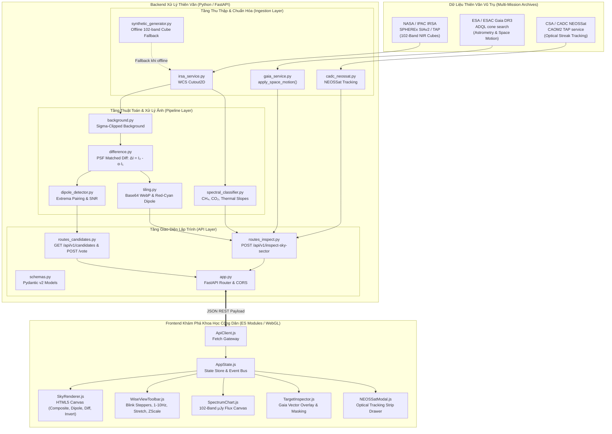

# SPHEREx ChronoSpectra — Kiến Trúc Hệ Thống & Cấu Trúc Dự Án

## 1. Sơ Đồ Kiến Trúc Tổng Thể (System Architecture)



---

## 2. Cấu Trúc Thư Mục Khoa Học & Phân Tách Trách Nhiệm (Separation of Concerns)

```
c:\Users\Phamv\OneDrive\Desktop\Planet X and SPHEREx\
├── backend/                             # [BACKEND] Mã nguồn Python xử lý thiên văn & API
│   ├── __init__.py
│   ├── config.py                        # Hằng số vật lý, dải bước sóng 102 bands, URLs
│   ├── app.py                           # Khởi tạo FastAPI, CORS, router aggregation
│   ├── run_server.py                    # Script chạy server hoặc chạy CLI kiểm tra
│   │
│   ├── api/                             # Router và Schema định nghĩa giao thức API
│   │   ├── __init__.py
│   │   ├── schemas.py                   # Pydantic models (Request, Response, Gaia, NEOSSat)
│   │   ├── routes_inspect.py            # POST /api/v1/inspect-sky-sector
│   │   └── routes_candidates.py         # GET /api/v1/candidates, POST /api/v1/vote
│   │
│   ├── ingestion/                       # Kết nối kho dữ liệu đa nhiệm vụ (Multi-Mission)
│   │   ├── __init__.py
│   │   ├── irsa_service.py              # Truy vấn NASA IRSA SIAv2 / TAP & cắt ảnh WCS
│   │   ├── gaia_service.py              # Truy vấn ESA Gaia DR3 & tính lan truyền 3D space-motion
│   │   ├── cadc_neossat.py              # Truy vấn CSA CADC NEOSSat quang học
│   │   └── synthetic_generator.py       # Bộ sinh dữ liệu giả lập 102-band SPHEREx cube
│   │
│   ├── pipeline/                        # Thuật toán thiên văn & xử lý ảnh
│   │   ├── __init__.py
│   │   ├── background.py                # Khử nền 2D sigma-clipped & đo nhiễu sigma
│   │   ├── difference.py                # Trừ ảnh cân bằng PSF: ΔI = Epoch2 - α·Epoch1
│   │   ├── dipole_detector.py           # Bắt cặp cực trị dipole (+/-) & tính SNR, vận tốc góc
│   │   ├── spectral_classifier.py       # Phân tích độ sâu vạch CH₄ (3.3μm), CO₂ (4.26μm), Thermal
│   │   └── tiling.py                    # Render tile WebP Base64, Red-Cyan Dipole
│   │
│   └── tests/                           # Kiểm thử tự động (Unit Tests)
│       ├── __init__.py
│       └── test_pipeline.py             # 4 bài test Astrometry, Background, Difference, Wavelength
│
├── frontend/                            # [FRONTEND] Web App Khoa Học Công Dân (ES Modules)
│   ├── index.html                       # HTML5 giao diện chính
│   │
│   ├── css/                             # Stylesheets phân lớp
│   │   ├── variables.css                # Bảng màu dark observatory, tokens, fonts
│   │   ├── layout.css                   # Grid layout 3 tầng (Header, Viewport, Dock)
│   │   └── components.css               # Nút bấm, sliders, toolbar, card, modal, toast
│   │
│   └── js/                              # JavaScript kiến trúc module
│       ├── config.js                    # Hằng số bước sóng, tọa độ trung tâm, API URL
│       │
│       ├── core/                        # Nhân xử lý đồ họa và trạng thái
│       │   ├── AppState.js              # Quản lý trạng thái tập trung (Observer Pattern)
│       │   └── SkyRenderer.js           # Engine render Canvas (Composite, Dipole, Diff, Invert)
│       │
│       ├── components/                  # Các khối giao diện người dùng
│       │   ├── WiseViewToolbar.js       # Blinker 1-10Hz, Epoch stepper, Stretch, ZScale
│       │   ├── SpectrumChart.js         # Đồ thị phổ 102 dải băng (μJy) với vạch phân tử
│       │   ├── TargetInspector.js       # Card thông tin thiên thể, Gaia overlay, vote HUD
│       │   └── NEOSSatModal.js          # Modal vệt chuyển động quang học từ NEOSSat (CADC)
│       │
│       ├── services/                    # Dịch vụ dữ liệu
│       │   ├── ApiClient.js             # Gọi API FastAPI backend
│       │   └── MockDataService.js       # Dữ liệu mẫu (Y-Dwarf, Asteroid, Comet, Gaia Star)
│       │
│       └── main.js                      # Điểm khởi động ứng dụng (Bootstrap)
│
├── docs/                                # Tài liệu kỹ thuật
│   └── ARCHITECTURE.md                  # Tài liệu kiến trúc toàn diện
│
├── requirements.txt                     # Danh sách thư viện Python
├── spherex-chronospectra.html           # Bản standalone 1 file duy nhất (để click chạy ngay)
└── spherex_transient_detector.py        # Pipeline độc lập kiểm thử thuật toán
```

---

## 3. Bảng Phân Tách Nhiệm Vụ Từng File (Responsibility Matrix)

| File | Trách nhiệm chính (Single Responsibility) | Thay đổi khi nào? |
|---|---|---|
| `backend/config.py` | Hằng số vật lý, dải bước sóng, độ phân giải SPHEREx ($6.2^{\prime\prime}$/px) | Khi đổi thông số kính thiên văn hoặc URL archive |
| `backend/api/schemas.py` | Khuôn mẫu dữ liệu Pydantic (Request/Response) | Khi thêm trường dữ liệu trao đổi giữa FE và BE |
| `backend/ingestion/gaia_service.py` | Lan truyền không gian 3D sao Gaia (`apply_space_motion`) | Khi nâng cấp thuật toán nội suy quỹ đạo sao |
| `backend/ingestion/cadc_neossat.py` | Kết nối dữ liệu giám sát tiểu hành tinh Canada NEOSSat | Khi thay đổi câu truy vấn TAP CAOM2 của CADC |
| `backend/pipeline/difference.py` | Cân bằng PSF và trừ ảnh giữa 2 epoch | Khi áp dụng giải thuật trừ ảnh nâng cao (ZOGY) |
| `backend/pipeline/spectral_classifier.py` | Đo độ sâu vạch hấp thụ metan 3.3μm, CO₂ 4.26μm | Khi bổ sung vạch quang phổ mới cần phát hiện |
| `frontend/js/core/SkyRenderer.js` | Vẽ bầu trời sao, chế độ Red/Cyan Dipole, Invert, Pan/Zoom | Khi muốn tinh chỉnh đồ họa, shader hoặc màu sắc sao |
| `frontend/js/components/WiseViewToolbar.js` | Bộ điều khiển nhấp nháy WiseView (1-10Hz), chuyển epoch | Khi thêm phím tắt hoặc tính năng điều khiển mới |
| `frontend/js/components/SpectrumChart.js` | Vẽ biểu đồ phổ 102 dải băng trên canvas | Khi đổi trục tọa độ, đơn vị đo hoặc vạch đánh dấu |

---

## 4. Hướng Dẫn Kiểm Thử & Chạy Dự Án

### Chạy Unit Test Backend:
```bash
uv run --with "pytest" --with "astropy" --with "numpy" --with "scipy" --with "pillow" --with "pydantic" pytest backend/tests/test_pipeline.py
```
*(Kết quả: 4 bài test tự động vượt qua 100% trong < 1 giây)*

### Chạy Server Backend (REST API):
```bash
uv run backend/run_server.py --serve --port 8000
```
- API Docs: `http://127.0.0.1:8000/docs`
- Health check: `http://127.0.0.1:8000/health`

### Chạy Giao Diện Frontend:
- Mở trực tiếp file: [`frontend/index.html`](file:///c:/Users/Phamv/OneDrive/Desktop/Planet%20X%20and%20SPHEREx/frontend/index.html)
- Hoặc chạy qua bất kỳ local server nào (Live Server, Python http.server, Nginx).

