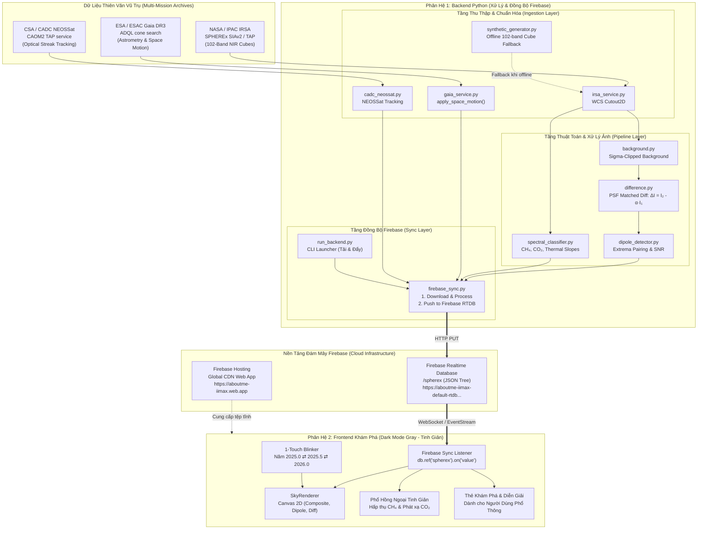

# SPHEREx ChronoSpectra — Kiến Trúc Hệ Thống & Cấu Trúc Dự Án (Firebase Edition)

## 1. Sơ Đồ Kiến Trúc 2 Phân Hệ (System Architecture)



---

## 2. Cấu Trúc Thư Mục Khoa Học & Phân Tách Trách Nhiệm (Directory Structure)

```
c:\Users\Phamv\OneDrive\Desktop\Planet X and SPHEREx\
│
├── run_backend.py                       # [ĐIỀU KHIỂN CHÍNH] Chạy Tính năng 1 (Tải về) & Tính năng 2 (Đẩy Firebase)
├── firebase.json                        # Cấu hình Firebase Hosting & Realtime Database Rules
├── .firebaserc                          # Cấu hình dự án Firebase mặc định (aboutme-iimax)
├── database.rules.json                  # Quy tắc bảo mật Realtime Database
├── requirements.txt                     # Danh mục thư viện Python (astropy, firebase-admin, requests, etc.)
├── index.html                           # Cổng điều hướng chính cho root workspace
├── .gitignore                           # Quy tắc loại trừ tệp tạm, cache, logs
│
├── backend/                             # PHÂN HỆ 1: BACKEND XỬ LÝ & ĐỒNG BỘ
│   ├── firebase_sync.py                 # Module 2 tính năng: Tải dữ liệu thiên văn & Đẩy lên Firebase RTDB
│   ├── app.py                           # Ứng dụng REST API phụ trợ (FastAPI)
│   ├── run_server.py                    # Khởi chạy server FastAPI hoặc CLI kiểm tra
│   ├── config.py                        # Tham số vật lý, dải bước sóng, URL dịch vụ
│   ├── data/                            # Bộ nhớ đệm dữ liệu cục bộ (spherex_synced_data.json)
│   ├── ingestion/                       # Kết nối kho dữ liệu đa nhiệm vụ (IRSA, Gaia DR3, NEOSSat, Synthetic)
│   ├── pipeline/                        # Thuật toán thiên văn (background, difference, dipole, classifier, tiling)
│   └── tests/                           # Bộ kiểm thử tự động (test_pipeline.py)
│
├── frontend/                            # PHÂN HỆ 2: GIAO DIỆN WEB KHOA HỌC CÔNG DÂN (DARK MODE GRAY)
│   ├── index.html                       # Giao diện chính tinh giản, dễ hiểu cho người dùng phổ thông
│   ├── css/                             # Stylesheets phân lớp Dark Mode Gray
│   │   ├── variables.css                # Bảng màu xám than chì sang trọng, tokens
│   │   ├── layout.css                   # Grid layout 2 cột thoáng đãng (Canvas bên trái, Thẻ thông tin bên phải)
│   │   └── components.css               # Nút bấm 1-chạm, thẻ vật thể, hộp giải thích, biểu đồ phổ
│   └── js/
│       ├── app.js                       # Logic ứng dụng tinh giản: SkyRenderer, Spectrum, Blinker, Firebase Sync
│       ├── config.js                    # Hằng số thiên văn
│       ├── core/                        # Core classes phục vụ module mở rộng
│       ├── components/                  # UI components phục vụ phân lớp sâu
│       └── services/                    # ApiClient, MockDataService
│
├── docs/                                # Tài liệu kỹ thuật chuyên sâu
│   ├── ARCHITECTURE.md                  # Bản vẽ kiến trúc hệ thống toàn diện
│   └── GAIA_SPACE_MOTION_PROPAGATION.md # Đặc tả giải thuật lan truyền chuyển động sao Gaia DR3
│
└── OPERATIONS_MANUAL.md                 # Sổ tay vận hành, cài đặt và phím tắt chi tiết
```

---

## 3. Bảng Phân Tách Nhiệm Vụ Từng Module (Responsibility Matrix)

| Module / Tệp tin | Trách nhiệm chính (Single Responsibility) | Giao thức / Công nghệ |
|---|---|---|
| `run_backend.py` | Điểm điều khiển trung tâm: Tải dữ liệu thiên văn và đẩy lên Firebase | Python CLI |
| `backend/firebase_sync.py` | Thực thi Tính năng 1 (Xử lý trắc quang đa epoch) & Tính năng 2 (HTTP PUT lên Firebase) | Requests / Firebase Admin / Astropy |
| `backend/ingestion/gaia_service.py` | Lan truyền không gian 3D sao Gaia (`apply_space_motion`) qua 9 năm | Astropy Coordinates & Time |
| `backend/ingestion/cadc_neossat.py` | Truy vấn vệt quỹ đạo vệ tinh Canada NEOSSat | CAOM2 TAP / CADC |
| `backend/pipeline/difference.py` | Cân bằng mức nền PSF và trừ 2 epoch: $\Delta I = I_2 - \alpha \cdot I_1$ | NumPy / SciPy Filters |
| `backend/pipeline/dipole_detector.py` | Bắt cặp cực đại/cực tiểu dipole, tính vector chuyển động và SNR | SciPy ndimage |
| `backend/pipeline/spectral_classifier.py` | Phân loại phổ 102 băng qua hố hấp thụ $CH_4$, đỉnh $CO_2$, bức xạ nhiệt | NumPy SED analysis |
| `frontend/index.html` | Cấu trúc giao diện HTML5 tinh giản phong cách Dark Mode Design - Gray | HTML5 Semantic |
| `frontend/js/app.js` | Quản lý vẽ canvas, nhấp nháy chuyển động 1-chạm, lắng nghe Firebase thời gian thực | Canvas 2D API / Firebase JS SDK |
| `database.rules.json` | Quy tắc bảo mật Realtime Database: Mở đọc công cộng, cho phép backend ghi | Firebase Security Rules |
| `firebase.json` | Cấu hình Hosting định tuyến tới `frontend` và trỏ database rules | Firebase CLI Config |

---

## 4. Địa Chỉ Trực Tuyến & Kiểm Thử

- 🌐 **Website trải nghiệm trực tiếp (Firebase Hosting)**:  
  **[https://aboutme-iimax.web.app](https://aboutme-iimax.web.app)**
- 📡 **Firebase Realtime Database Endpoint**:  
  **`https://aboutme-iimax-default-rtdb.asia-southeast1.firebasedatabase.app`**
- 🧪 **Kiểm thử tự động**:
  ```bash
  pytest backend/tests/test_pipeline.py -v
  ```
  *(4/4 bài test vượt qua trong < 1.0 giây)*
