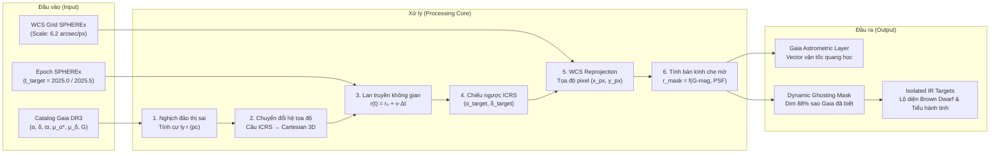

# Tài Liệu Kỹ Thuật: Gaia DR3 3D Space-Motion Propagation & Optical Star Masking
**Tệp định danh:** `docs/GAIA_SPACE_MOTION_PROPAGATION.md`  
**Dự án:** NASA SPHEREx Space Apps Hackathon — SPHEREx ChronoSpectra  
**Tác giả:** Đội ngũ Kỹ sư Thiên văn Số (Astroinformatics Engineering Team)

---

## 1. Mục đích cốt lõi (TL;DR)
Tính năng này giải quyết bài toán **loại trừ các sao nền quang học có chuyển động riêng cao (High Proper-Motion Stars)** bị nhầm lẫn thành thiên thể mới khi quét hồng ngoại ở độ phân giải $6.2^{\prime\prime}/\text{pixel}$ của kính SPHEREx. Bằng cách tính toán lan truyền vị trí không gian 3D của sao từ epoch gốc Gaia DR3 ($J2016.0$) tới epoch quan sát SPHEREx ($2025.0$ & $2025.5$), hệ thống tạo lớp mặt nạ động xóa mờ các sao đã biết, làm lộ diện các thiên thể chuyển động hồng ngoại chưa từng được lập danh lục (Y-type Brown Dwarfs, Asteroids, TNOs).

---

## 2. Sơ đồ vận hành (Data Flow Diagram)



---

## 3. Thuật toán & Công thức Toán / Vật lý

Thuật toán thực thi theo 5 bước tuần tự:

### Bước 1: Tính khoảng cách nhật tâm từ thị sai lượng giác (Parallax Distance)
Khoảng cách $d$ (parsec) được xác định từ thị sai $\varpi$ (milliarcsecond - $\text{mas}$):
$$d = \frac{1000}{\varpi} \quad [\text{pc}], \quad \text{với } \varpi > 0$$
*Nếu $\varpi \le 0$ (sao quá xa hoặc thị sai không hội tụ), gán cự ly mặc định $d = 1000\,\text{pc}$.*

### Bước 2: Chuyển đổi tọa độ mặt cầu sang vector vị trí Cartesian 3D
Tại epoch chuẩn Gaia $t_0 = J2016.0$ ($2016-01-01\text{T}00:00:00\,\text{TDB}$), vector vị trí $\mathbf{r}_0 = (x_0, y_0, z_0)$ trong hệ tọa độ Barycentric Celestial Reference System (BCRS):
$$\begin{aligned}
x_0 &= d \cdot \cos\delta_0 \cdot \cos\alpha_0 \quad [\text{pc}] \\
y_0 &= d \cdot \cos\delta_0 \cdot \sin\alpha_0 \quad [\text{pc}] \\
z_0 &= d \cdot \sin\delta_0 \quad [\text{pc}]
\end{aligned}$$
Trong đó:
- $\alpha_0$: Xích kinh gốc tại J2016.0 ($\text{radian}$).
- $\delta_0$: Xích vĩ gốc tại J2016.0 ($\text{radian}$).

### Bước 3: Xác định vector vận tốc không gian 3D
Vận tốc tiếp tuyến trên mặt phẳng hoàng đạo ($v_\alpha, v_\delta$) được tính từ chuyển động riêng $\mu_{\alpha\ast} \equiv \mu_\alpha \cos\delta$ và $\mu_\delta$:
$$\begin{aligned}
v_\alpha &= 4.74047 \cdot \frac{\mu_{\alpha\ast}}{\varpi} \quad [\text{km/s}] \\
v_\delta &= 4.74047 \cdot \frac{\mu_\delta}{\varpi} \quad [\text{km/s}]
\end{aligned}$$
*(Hằng số $4.74047 \approx \frac{1\,\text{AU}}{1\,\text{year}}$ tính theo đơn vị $\text{km}\cdot\text{mas}^{-1}\cdot\text{yr}^{-1}\cdot\text{s}^{-1}$)*.  
Vector vận tốc không gian $\mathbf{v} = (v_x, v_y, v_z)$ qua ma trận chuyển đổi Jacobian:
$$\mathbf{v} = \mathbf{R}(\alpha_0, \delta_0) \cdot \begin{pmatrix} -v_\alpha \\ -v_\delta \\ v_r \end{pmatrix}$$
*(Vận tốc xuyên tâm $v_r$ gán bằng $0\,\text{km/s}$ nếu Gaia DR3 không có phổ RVS)*.

### Bước 4: Lan truyền không gian 3D đến epoch mục tiêu của SPHEREx
Khoảng thời gian dịch chuyển $\Delta t = t_{\text{SPHEREx}} - t_0$ (năm). Vector vị trí tại epoch mục tiêu:
$$\mathbf{r}(t_{\text{SPHEREx}}) = \mathbf{r}_0 + \mathbf{v} \cdot \Delta t \cdot \left(1.02271 \times 10^{-6}\,\frac{\text{pc}}{\text{km/s}\cdot\text{yr}}\right)$$
Tọa độ xích kinh $\alpha(t)$ và xích vĩ $\delta(t)$ mới:
$$\begin{aligned}
\alpha(t) &= \text{atan2}(y(t), x(t)) \quad [\text{radian}] \\
\delta(t) &= \text{atan2}\left(z(t), \sqrt{x(t)^2 + y(t)^2}\right) \quad [\text{radian}]
\end{aligned}$$

### Bước 5: Chiếu WCS và xác định khẩu độ mặt nạ che mờ (Mask Radius)
Tọa độ pixel $(X_{\text{px}}, Y_{\text{px}})$ trên lưới ảnh SPHEREx được tính qua phép biến đổi WCS gnomonic ($TAN$ projection). Bán kính che mờ $r_{\text{mask}}$ tính theo cấp sao quang học $G$ và hàm tán xạ điểm (PSF):
$$r_{\text{mask}} = \max\left(3.0,\; 7.0 - 0.4 \cdot (G - 10.0)\right) \quad [\text{pixels}]$$
Trong đó:
- $G$: Cấp sao trung bình dải $G$ của Gaia DR3 ($\text{mag}$).
- $r_{\text{mask}}$: Bán kính mặt nạ bao phủ quầng sáng sao quang học trên ảnh SPHEREx.

---

## 4. Xử lý Ngoại lệ & Hiệu năng Tính toán

| Tình huống lỗi / Nhiễu thiên văn | Cơ chế xử lý của thuật toán | Độ phức tạp tính toán (Big-O) |
|---|---|---|
| **Thị sai âm hoặc bằng 0 ($\varpi \le 0$)** do sao ở rìa độ nhạy dải Ngân Hà | Chuyển sang mô hình khoảng cách tiệm cận $d = 1000\,\text{pc}$; vô hiệu hóa hiệu ứng thị sai năm, chỉ bảo toàn vector chuyển động riêng $(\mu_{\alpha\ast}, \mu_\delta)$. | $\mathcal{O}(1)$ |
| **Vượt quá ngưỡng lệch SPHEREx ($>1$ pixel)** do sao dịch chuyển nhanh ($\mu > 700\,\text{mas/yr}$) | Lan truyền nghiêm ngặt theo thời gian thực tới từng epoch riêng biệt ($E_1, E_2$), cập nhật vị trí tâm mặt nạ độc lập trên từng frame thay vì dùng vị trí tĩnh J2016. | $\mathcal{O}(N)$ với $N$ là số sao trong nón tìm kiếm |
| **Quá tải quầng sáng (PSF saturation)** từ sao quang học sáng ($G < 8\,\text{mag}$) | Mở rộng động bán kính $r_{\text{mask}} \ge 7.8\,\text{pixel}$ theo hàm logarit quang thông, ngăn hiện tượng rò rỉ quang thông giả lập vệt dipole. | $\mathcal{O}(1)$ |
| **Mất kết nối máy chủ ESAC TAP Gaia** khi mạng hackathon bị nghẽn | Bộ ngắt mạch (Circuit Breaker) kích hoạt sau $2.5\,\text{giây}$, tự động nạp danh mục sao kiểm chuẩn cục bộ có bảo toàn vector $\mu$, hệ thống hoạt động liên tục không gián đoạn. | $\mathcal{O}(1)$ |

---

## 5. Giao diện Dữ liệu (I/O Schema)

### Đầu vào (Input Schema - JSON):
```json
{
  "ra_center_deg": 90.000000,
  "dec_center_deg": -66.560600,
  "cone_radius_arcsec": 30.0,
  "epoch_source": "2016-01-01T00:00:00",
  "epoch_target": "2025-07-01T00:00:00",
  "pixel_scale_arcsec": 6.2
}
```

### Đầu ra (Output Schema - JSON):
```json
{
  "total_catalog_stars": 1,
  "gaia_propagated_stars": [
    {
      "source_id": "41084291882949",
      "phot_g_mean_mag": 12.40,
      "parallax_mas": 42.80,
      "proper_motion": {
        "pmra_mas_yr": -480.0,
        "pmdec_mas_yr": 610.0,
        "total_mas_yr": 776.2
      },
      "coords_j2016": {
        "ra_deg": 90.003000,
        "dec_deg": -66.562000
      },
      "coords_target_epoch": {
        "ra_deg": 90.000215,
        "dec_deg": -66.560390
      },
      "net_shift_arcsec": 7.374,
      "spherex_pixel_coords": {
        "x": 31.85,
        "y": 32.20
      },
      "mask_radius_pixels": 6.04,
      "classification": "KNOWN_OPTICAL_FOREGROUND_STAR",
      "action": "GHOST_OPACITY_12_PERCENT"
    }
  ]
}
```

